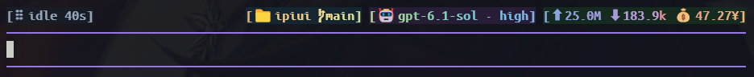

# ipiui

A Pi extension that adds a compact status row above Pi's native editor and aggregates pane titles across terminal panes.

- [中文使用指南](README.zh-CN.md)
- [Status row preview gallery](docs/styles-gallery.html)



## Requirements

- Pi 1.5.0 or newer (tested with Pi 1.5.0)
- Node.js 22.19 or newer

Pi loads the TypeScript extension directly; no build step is needed.

## Install

Install the checked-out package directory:

```sh
pi install /absolute/path/to/ipiui
```

On Windows, for example:

```powershell
pi install I:/ispace/ipiui
```

For a project-local install, add `--local`. Pi will load the package directory in place, so keep it available. After this repository is pushed, the Git source can be installed with:

```sh
pi install git:github.com/ityme/ipiui
```

After publication to npm, use `pi install npm:ipiui`. The repository is not published to npm yet.

Restart Pi or run `/reload` after installation. To try a checkout for one invocation without saving package settings:

```sh
pi -e /absolute/path/to/ipiui
```

If this directory is already listed in your Pi `extensions` setting, remove that duplicate entry after installing it as a package.

## Status row

The row appears above Pi's native editor. It retains the native prompt, completion menu, paste, IME, mouse and keyboard handling. The footer is left empty. Five compact blocks show:

1. Pi run status and elapsed time. Labels are lowercase: `working` during execution, `thinking` during a provider's thinking stream, and `error` on failure. Thinking ends when the provider reports it or tool execution starts. Providers without thinking stream events keep the `working` label.
2. Project directory and Git branch.
3. Model and thinking level.
4. Input/output tokens and estimated cost. The cost number is Pi's estimate; the displayed `¥` is a requested label, not currency conversion.
5. Context usage bar, percentage and token limit.

Right-side fields use fixed colors: soft yellow for project, pale blue for branch and input tokens, muted blue-gray for model names, brighter lavender for thinking levels, soft green for output tokens, and gold for cost. Context labels use teal-gray, the empty track is muted, and token counts use a separate neutral tone. The filled bar and percentage use teal through 60%, amber above 60%, and coral above 80%. Brackets and separators are neutral gray. Each icon receives the same ANSI foreground as its associated text; color emoji may retain their font-defined colors. During working/thinking, a subtle highlight sweeps across them every eight seconds; idle, error and aborted states stay static. Semantic status colors remain vivid, while idle stays neutral gray. Foreground colors preserve WCAG AA text contrast in dark and light appearances. Narrow terminals hide blocks by priority instead of overflowing.

## Commands

Run `/ipiui` to open the interactive settings panel. Use the arrow keys to choose an action, Enter to confirm and Esc to cancel or go back.

The panel lets you:

- Show or hide the status row (for example, `Hide status row(隐藏状态栏)`).
- Set a custom pane name or reset it to the project directory name.
- Enable/disable title synchronization or switch groups.
- View help.

Direct commands are also available:

| Command | Action |
|---|---|
| `/ipiui on`, `/ipiui off`, `/ipiui toggle` | Control status row visibility |
| `/ipiui name NAME` | Set the pane title label |
| `/ipiui name reset` | Follow the project directory name again |
| `/ipiui group NAME` | Join or switch the shared title group |
| `/ipiui group off` | Disable title synchronization |
| `/ipiui status`, `/ipiui help` | Show current settings or command help |

Compatibility aliases remain available: `/topbar`, `/tabname` and `/tabgroup`.

## Terminal pane titles

All Pi instances join the `all` group by default and aggregate their titles. Each member shows a braille spinner while running; idle or completed panes show just their label. Animated frames use in-memory records; temporary files synchronize state between separate Pi processes once per second. The files are removed on clean shutdown, and abandoned records expire. If the temporary sync directory disappears, ipiui recreates it automatically. Other sync failures retry with exponential backoff (up to 30 seconds); a warning appears only after three consecutive failures and includes the operation/error code, without local paths. Successful synchronization resets the failure state.

By default, `all` is shared across terminal windows too. To isolate windows, assign the same custom group to panes that should share a title, and a different group to other windows. Set `IPIUI_GROUP` before starting Pi, or run `/ipiui group NAME` in each pane. Windows Terminal's `WT_SESSION` identifies an individual pane connection, so the extension does not use it as a window identifier.

Terminal titles are plain text; they cannot use the status row's ANSI colors. No title color escape sequences are emitted.

## Development and release checks

```sh
npm test
npm run check
npm run check:package
```

`npm run check:package` creates a tarball, installs it with the Pi CLI in an isolated configuration directory, and verifies package discovery, extension loading and removal. It does not modify your normal Pi settings or call a model.

Create a local release archive with:

```sh
mkdir -p dist
npm pack --pack-destination dist
```

The archive contains the runtime source, metadata, documentation and license, but excludes tests and development scripts.

## License

GPL-3.0-only. See [LICENSE](LICENSE).
