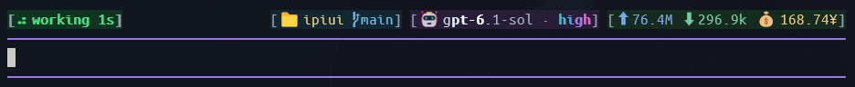

# ipiui

A Pi extension that adds a compact status row above Pi's native editor and aggregates pane titles across terminal panes.

- [中文使用指南](README.zh-CN.md)
- [Status row preview gallery](docs/styles-gallery.html)




## Requirements

- Pi 1.5.0 or newer (tested with Pi 1.5.0)
- Node.js 22.19 or newer

Pi loads the TypeScript extension directly; no build step is needed.

## Install

Install the checked-out package directory:

```sh
pi install /absolute/path/to/ipiui
```

On Windows, for example:

```powershell
pi install I:/ispace/ipiui
```

For a project-local install, add `--local`. Pi will load the package directory in place, so keep it available. After this repository is pushed, the Git source can be installed with:

```sh
pi install git:github.com/ityme/ipiui
```

The npm package name is `@ityme/ipiui` (the unscoped name is rejected by npm because it resembles another package). After publication, install with `pi install npm:@ityme/ipiui`. To publish from this directory, run `npm publish --access public`. The Pi command remains `/ipiui`.

Restart Pi or run `/reload` after installation. To try a checkout for one invocation without saving package settings:

```sh
pi -e /absolute/path/to/ipiui
```

If this directory is already listed in your Pi `extensions` setting, remove that duplicate entry after installing it as a package.

## Status row

The row appears above Pi's native editor. It retains the native prompt, completion menu, paste, IME, mouse and keyboard handling. The footer is left empty. Five compact blocks show:

1. Pi run status and elapsed time. Labels are lowercase: `working` during execution, `thinking` during a provider's thinking stream, and `error` on failure. Thinking ends when the provider reports it or tool execution starts. Providers without thinking stream events keep the `working` label.
2. Project directory and Git branch.
3. Model and thinking level.
4. Input/output tokens and estimated cost. The cost number is Pi's estimate; the displayed `¥` is a requested label, not currency conversion.
5. Context usage bar, percentage and token limit.

Right-side fields use fixed colors: soft yellow for project, pale blue for branch and input tokens, muted blue-gray for model names, a distinct fixed color per letter for thinking levels, soft green for output tokens, and gold for cost. Context labels use teal-gray, the empty track is muted, and token counts use a separate neutral tone. The filled bar and percentage use teal through 60%, amber above 60%, and coral above 80%. Brackets and separators are neutral gray. Each icon receives the same ANSI foreground as its associated text; color emoji may retain their font-defined colors. During working/thinking, a 2–3-column highlight head travels left to right across all visible right-side fields, followed by a 4–6-column fading tail. It travels for 4.5 seconds, pauses for 0.5 seconds, then repeats. The effect preserves each field's hue and chroma (including the multicolor thinking letters), changing only lightness; light appearance uses stronger ink for contrast. Idle, error and aborted states stay static. Semantic status colors remain vivid, while idle stays neutral gray. Foreground colors preserve WCAG AA text contrast in dark and light appearances. Narrow terminals hide blocks by priority instead of overflowing.

## Themes

- **`chase` (default):** fixed field colors, multicolor thinking letters and the running highlight chase described above.
- **`rainbow`:** a continuous seven-color band across the project, model, usage and context blocks. It flows while working/thinking and freezes at idle. It uses the same layout and backgrounds, with no chase overlay.

Choose a theme in `/ipiui` → `Theme` (or `主题` in Chinese), or run `/ipiui theme chase` / `/ipiui theme rainbow`. `/ipiui theme` shows the selected theme. The choice is stored in the active Pi session branch, restored on `/reload` or resuming that session, and follows `/tree` navigation. It does not change Pi's global theme or other sessions.

## Commands

Run `/ipiui` to open the interactive settings panel. Language is the first row; main settings and theme descriptions use Pi's native SelectList label/description columns. Open Status row to choose On or Off explicitly; Enter on the main row does not toggle it. Use the arrow keys to choose an action, Enter to confirm and Esc to cancel or go back.

The panel lets you:

- Show or hide the status row.
- Set a custom pane name or reset it to the project directory name.
- Enable/disable title synchronization or switch groups.
- Enable/disable the title activity spinner independently of synchronization.
- Choose the Chase or Rainbow theme.
- Switch panel language between English and Simplified Chinese.
- View help.

The panel defaults to English. Open `/ipiui` → `Language` and choose `English` or `简体中文`, or run `/ipiui language en` / `/ipiui language zh`. Menus, prompts, command feedback and help switch immediately. The choice is saved to the active Pi session branch and restored on `/reload`, resume and `/tree` navigation. It does not change other sessions or the status row's `working` / `thinking` / `error` labels.

Direct commands are also available:

| Command | Action |
|---|---|
| `/ipiui on`, `/ipiui off`, `/ipiui toggle` | Control status row visibility |
| `/ipiui name NAME` | Set the pane title label |
| `/ipiui name reset` | Follow the project directory name again |
| `/ipiui group NAME` | Join or switch the shared title group |
| `/ipiui group off` | Disable title synchronization |
| `/ipiui indicator [on|off]` | View or toggle the title activity spinner (on by default) |
| `/ipiui theme [chase|rainbow]` | View or change the status row theme |
| `/ipiui language [en|zh]` | View or change the panel language |
| `/ipiui status`, `/ipiui help` | Show current settings or command help |

Compatibility aliases remain available: `/topbar`, `/tabname` and `/tabgroup`.

## Terminal pane titles

Title synchronization is disabled by default. Enable it in `/ipiui` → Title sync, or run `/ipiui group NAME`. The title activity spinner is a separate setting, enabled by default; control it in `/ipiui` → Title activity or with `/ipiui indicator on|off`. With synchronization off, the current pane's title shows the spinner while that Pi process is running. Turning the indicator off restores the plain `pi` title unless group synchronization is active. The panel uses `IPIUI_GROUP` (or `all`) as the suggested default group; setting the environment variable does not enable synchronization automatically. Each member's braille spinner can be hidden independently; idle or completed panes show just their label. Animated frames use in-memory records; temporary files synchronize state between separate Pi processes once per second. The files are removed on clean shutdown, and abandoned records expire. If the temporary sync directory disappears, ipiui recreates it automatically. Other sync failures retry with exponential backoff (up to 30 seconds); a warning appears only after three consecutive failures and includes the operation/error code, without local paths. Successful synchronization resets the failure state.

When enabled, the `all` group is shared across terminal windows too. To isolate windows, assign the same custom group to panes that should share a title, and a different group to other windows. Set `IPIUI_GROUP` before starting Pi to choose the panel's default group, then enable synchronization in the panel; or run `/ipiui group NAME` in each pane. Windows Terminal's `WT_SESSION` identifies an individual pane connection, so the extension does not use it as a window identifier.

Terminal titles are plain text; they cannot use the status row's ANSI colors. No title color escape sequences are emitted.

## Development and release checks

```sh
npm test
npm run check
npm run check:package
```

`npm run check:package` creates a tarball, installs it with the Pi CLI in an isolated configuration directory, and verifies package discovery, extension loading and removal. It does not modify your normal Pi settings or call a model.

Create a local release archive with:

```sh
mkdir -p dist
npm pack --pack-destination dist
```

The archive contains the runtime source, metadata, documentation and license, but excludes tests and development scripts.

## License

GPL-3.0-only. See [LICENSE](LICENSE).
