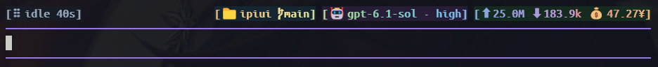

# ipiui 使用指南

`ipiui` 是 Pi 扩展，在 Pi 原生输入框上方显示紧凑状态栏，并聚合终端多窗格标题。

- [English README](README.md)
- [状态栏样式预览](docs/styles-gallery.html)



## 环境要求

- Pi 1.5.0 或更新版本（已用 Pi 1.5.0 测试）
- Node.js 22.19 或更新版本

Pi 直接加载 TypeScript 扩展，无需构建。

## 安装

从本地项目目录安装：

```sh
pi install /绝对路径/ipiui
```

Windows 示例：

```powershell
pi install I:/ispace/ipiui
```

加上 `--local` 可只为当前项目安装。本地包是原位加载，请保留该目录。仓库推送后，也可以从 GitHub 安装：

```sh
pi install git:github.com/ityme/ipiui
```

npm 包名为 `@ityme/ipiui`（不带作用域的名称与已有包过于相似，被 npm 拒绝）。发布成功后使用 `pi install npm:@ityme/ipiui` 安装。在本项目目录执行 `npm publish --access public` 发布；Pi 内的命令仍为 `/ipiui`。

安装后重启 Pi 或运行 `/reload`。也可用以下命令只在当前 Pi 进程中试用，不写入包配置：

```sh
pi -e /绝对路径/ipiui
```

如果之前已将该目录加在 Pi 的 `extensions` 设置中，改用 package 安装后应删除重复的扩展路径。

## 状态栏

状态栏位于 Pi 原生编辑器上方，保留原生输入框、补全菜单、粘贴、IME、鼠标和快捷键处理；底部 footer 为空。状态栏包含五个信息块：

1. Pi 运行状态和耗时。执行时显示 `working`，收到思考流事件时显示 `thinking`，失败时显示 `error`，全部为小写。未提供思考流事件的模型继续显示 `working`。
2. 项目目录和 Git 分支。
3. 模型和思考等级。
4. 输入/输出 Token 和估算费用。费用数字来自 Pi 的估算；显示的 `¥` 是标记，并非汇率换算。
5. 上下文进度条、百分比和 Token 上限。

右侧按字段固定配色：项目为柔和黄，分支和输入 Token 为淡蓝，模型名为克制蓝灰，思考等级逐字母使用不同的固定颜色；输出 Token 为柔和绿，费用为金黄。CTX 标签为低饱和青蓝灰，空轨道为灰色，用量数字使用单独的中性色；已用进度与百分比在占用不超过 60% 时为青色、超过 60% 时为琥珀色、超过 80% 时为珊瑚红；括号和分隔点为中性灰。每个图标与对应文本使用相同 ANSI 前景色，但彩色 Emoji 可能保留字体自带颜色。working/thinking 时，约 2–3 列的高亮头从左向右依次经过右侧可见字段，后方带 4–6 列渐隐拖尾；行进 4.5 秒，末尾停顿 0.5 秒再循环。只调整原色明度，保留各字段色相、色度及思考等级逐字配色；浅色主题通过加深字色增强对比。空闲、错误、中断时保持静态。左侧语义状态色保持醒目，idle 为中性灰。深浅主题下文字均保持 WCAG AA 对比度。终端过窄时按优先级隐藏模块，避免横向溢出。

## 主题

- **`chase`（默认）**：当前固定字段配色、思考等级逐字多色，以及运行时逐字追光。
- **`rainbow`**：项目、模型、用量、CTX 四个模块共用连续七色色带，working/thinking 时流动，空闲时静止；保留现有布局和背景，不叠加追光。

运行 `/ipiui` → `Theme`（中文面板为“主题”）选择，也可直接执行 `/ipiui theme chase` 或 `/ipiui theme rainbow`；`/ipiui theme` 查看当前主题。选择保存到 Pi 当前会话分支，`/reload` 或恢复该会话时会还原，并随 `/tree` 导航恢复对应分支的选择；不修改 Pi 全局主题或其他会话。

## 交互面板

运行 `/ipiui` 打开面板。语言固定在第一行，主菜单和主题说明使用 Pi 原生 SelectList 的标签／说明两列布局。进入“状态栏”后明确选择“开启”或“关闭”，主菜单不再直接切换状态。使用方向键选择、Enter 确认、Esc 取消或返回。面板可执行：

- 显示或隐藏状态栏。
- 设置窗格标题名称，或恢复为项目目录名。
- 开启/关闭标题同步，或切换标题分组。
- 独立开启/关闭标题栏运行标识。
- 选择 Chase 或 Rainbow 主题。
- 切换中文或英文面板语言。
- 查看命令帮助。

面板默认使用英文。运行 `/ipiui` → `Language`，选择 `English` 或 `简体中文`；也可执行 `/ipiui language zh` 切换中文，`/ipiui language en` 切换英文。菜单、输入提示、命令反馈和帮助立即切换，不再双语堆叠。选择保存在 Pi 当前会话分支，重载、恢复会话或 `/tree` 导航后还原；不影响其他会话，也不改变状态栏的 `working` / `thinking` / `error` 标签。

## 命令速查

| 命令 | 作用 |
|---|---|
| `/ipiui`、`/ipiui menu` | 打开交互面板 |
| `/ipiui on`、`/ipiui off`、`/ipiui toggle` | 控制状态栏显示 |
| `/ipiui name NAME` | 设置窗格标题名称 |
| `/ipiui name reset` | 恢复跟随项目目录名 |
| `/ipiui group NAME` | 加入或切换标题分组 |
| `/ipiui group off` | 关闭标题同步 |
| `/ipiui indicator [on|off]` | 查看或切换标题栏运行标识（默认开启） |
| `/ipiui theme [chase|rainbow]` | 查看或切换状态栏主题 |
| `/ipiui language [en|zh]` | 查看或切换面板语言 |
| `/ipiui status`、`/ipiui help` | 查看当前设置或命令说明 |

兼容旧命令：`/topbar`、`/tabname`、`/tabgroup`。

## 终端窗格标题

标题同步默认关闭。在 `/ipiui` → 标题同步中手动开启，或运行 `/ipiui group NAME` 加入分组。标题栏运行标识是独立功能，默认开启；可在 `/ipiui` → 标题运行标识中控制，或运行 `/ipiui indicator on|off`。未开启同步时，运行中的当前窗格标题会显示旋转盲文符号；关闭运行标识后标题恢复为纯 `pi`，但已开启的分组同步不受影响。面板建议的默认分组为 `IPIUI_GROUP` 指定值（未设置则为 `all`）；设置环境变量不会自动开启标题同步。每个窗格的盲文旋转符号可独立于同步显示或隐藏；空闲或完成的窗格只显示名称。动画帧只用内存数据；不同 Pi 进程之间每秒通过临时文件同步状态。正常退出时删除自己的记录，异常退出后留下的记录会过期。临时同步目录被清理后会自动重建；其他同步失败采用指数退避重试，最长间隔 30 秒。连续失败 3 次后才提示操作步骤和错误码，不显示本地路径；同步恢复成功后重置失败状态。

开启同步后，`all` 分组也会跨终端窗口共享。若要隔离窗口，请让需要共享标题的窗格使用同一个自定义组名，其他窗口使用不同组名。可以在启动 Pi 前设置 `IPIUI_GROUP` 作为面板默认组名，再在面板中开启同步；也可以在各窗格运行 `/ipiui group NAME`。Windows Terminal 的 `WT_SESSION` 标识单个窗格连接，因此扩展不把它当作窗口标识。

终端标题是纯文本，不能使用状态栏的 ANSI 颜色；扩展不会向标题发送颜色转义序列。

## 开发和发布检查

```sh
npm test
npm run check
npm run check:package
```

`npm run check:package` 会生成 tarball，并在隔离的 Pi 配置目录中通过 Pi CLI 安装，验证 package 发现、扩展加载和卸载。不会改动你的常用 Pi 配置，也不会调用模型。

生成本地发布包：

```sh
mkdir -p dist
npm pack --pack-destination dist
```

发布包包含运行源码、包元数据、文档和许可证；测试和开发脚本不会进入包。

## 许可证

GPL-3.0-only，详见 [LICENSE](LICENSE)。
